# argue

[](https://www.npmjs.com/package/argue-ai)

**Put several AI models in a room. They argue it out. You get the one answer that survived.**

Use it for questions, decisions, plans, writing, or code changes, from any AI tool you already use.

<p align="center">
  <a href="docs/ARCHITECTURE.md"></a>
</p>
<p align="center"><sub>What happens under the hood when you say “argue this”. <a href="docs/ARCHITECTURE.md">Read how it works →</a></sub></p>

A real run (`argue "fix the LRU cache in lru.js so the tests pass"`):

```
⚔  argue · 2 agents · code change, checked by npm test --silent
   A  sonnet · Claude Code · effort default
   B  gpt-6.1-sol · Codex · effort high
── opening · each agent works alone
   B  ✓ 35s  check ✓ · backs own work · "Refresh Map insertion order on successful reads and writes…"
   A  ✓ 54s  check ✓ · backs own work · "Fixed LRU by moving accessed/updated keys to end via delete+set…"
── round 1 · A B
   B  ✓ 31s  challenges A #1 "Stored undefined values fail to refresh recency." · backs own work
   A  ✓ 1m03s  revised (v2) · check ✓ · backs own work
── round 2 · A B
   B  ✓ 20s  withdraws #1 · backs own work
   A  ✓ 29s  answers #1 · backs B
── red team · A tries to break B's work
   A  ✓ 2m25s  backs B
✓  Everyone agreed on B's work after 3 rounds (a red-team turn found nothing).
```

Both fixes passed the tests, but one agent spotted a bug the tests missed. The other fixed its own version, switched to backing the better one, then spent its red-team turn stress-testing it against a reference implementation before the room agreed.

## 1. Install

```bash
npm i -g argue-ai
```

You also need:
- **Node 20 or newer** and **git**
- **At least one AI coding tool, logged in.** Two from different labs work best.

| Tool | Install it with |
|---|---|
| Claude Code | `npm i -g @anthropic-ai/claude-code` |
| Codex | `npm i -g @openai/codex` |
| Gemini CLI | `npm i -g @google/gemini-cli` |
| Cursor CLI | `curl https://cursor.com/install -fsS \| bash` |
| OpenCode | `npm i -g opencode-ai` |
| Pi | `npm i -g @earendil-works/pi-coding-agent` |

## 2. Check your setup

```bash
argue doctor
```

This shows which AI tools argue found, which model each one uses, and who will argue by default. The first time, it also offers to connect argue to your AI tools. Press **Enter** to say yes.

## 3. Ask something

Run it **inside your project folder**:

```bash
argue "which database should our social media app use?"
argue "fix the failing login test"
```

You watch the room live, then get one answer. Your files never change until you run `argue apply`.

**Or, from inside your AI tool.** In Claude Code, Codex, Cursor, Pi, OpenCode or Gemini, when you doubt a proposal, just say:

> argue this proposal with other models

Your tool writes up the proposal and what you've discussed for the other models, shows who will argue and the limits, and starts right away:

```
⚔️ Arguing with:
- sonnet · effort default · Claude Code
- gpt-6.1-sol · effort high · Codex

ℹ️ Several models will each work on this, so it costs more and takes longer than asking one.
   Limits: up to 4 rounds · 60 min · $10.

Want other models or limits? Just say so (e.g. "use opus and gemini", "cap it at $3").
```

It's only a note: nothing waits for you. Say "use opus too" or "cap it at $3" at any time and the run restarts with that. Add "from now on" to make it your default.

## 4. After you get an answer

| You want to… | Run |
|---|---|
| Ask a follow-up ("why not MongoDB?") | `argue ask "why not MongoDB?"` |
| Apply the code change | `argue apply` |
| Read the whole debate: every post, challenge and revision | `argue show` |

## How the room works

1. **Every agent works alone first**, in its own private copy of your project, so nobody copies the first idea. Each one also says what tools it has (web search, a database, a CLI), so the others can ask it for help.
2. **Then they meet.** Each round, every agent reads the room and decides what to do: challenge someone's work with evidence, answer a challenge, fix its own work, borrow a better idea, ask another agent to check something, or back someone else's work.
3. **Agreement has to be earned.** The room only ends in agreement when everyone backs the same work, someone else has really challenged it, and (for code) its check passes. If everyone agrees at once, one agent is sent to try to break it first.
4. **It always ends.** When nobody has anything new to say, the room stops. Limits on rounds, time and money are a safety net.
5. **You get one answer**, written from the work that held up. If a real disagreement is still open, it ends with a short **Note:**.

The agents are letters to each other (A, B, C), so arguments win on evidence, not on which model made them. More in [how it works](docs/ARCHITECTURE.md).

## Choosing models

argue picks a lineup from the tools you have installed. To choose for one run, add `-a`:

```bash
argue "your question" -a opus,gpt-6.1-sol
```

- **A model name** (`opus`, `gpt-6.1-sol`, `gemini-2.5-pro`): argue finds the right tool for it.
- **A tool name** (`claude`, `codex`): that tool's usual model.
- **Thinking effort:** add `@high` or `@low` (e.g. `gpt-6.1-sol@high`). Works with Claude Code, Codex and Pi.
- **Only one tool?** Use two of its models (`claude:opus,claude:sonnet`) or the same one twice. It works, but models from different labs catch more of each other's mistakes.

To change your defaults:

```bash
argue lineup opus,gpt-6.1-sol@high   # checks the models exist, then saves them
argue lineup -b 5 -r 3               # default $ cap and rounds
argue lineup --reset                 # back to automatic
```

## Sharing tools between agents

By default agents get **no MCP servers**: an unattended agent with your Slack or Jira server could act on it. To let agents use specific servers from their own tool's config, list them in your settings (see below):

```json
{ "mcp": ["github", "postgres"] }
```

Claude Code and Codex agents then get exactly those. An agent that has a server can run it for the others when asked. `argue doctor` shows which shared servers each tool actually has.

## All commands

| Command | What it does |
|---|---|
| `argue "<question or task>"` | Run a room: get one checked answer, or a code change |
| `argue ask "<follow-up>"` | Ask about the last answer, from the run's record |
| `argue apply` | Apply the last code change to your files |
| `argue show` | The whole debate of the last run |
| `argue runs` | List past runs |
| `argue watch` | Follow a running room live |
| `argue cancel` | Stop a run |
| `argue doctor` | Check your setup |
| `argue lineup [models] [-b] [-r]` | Show or change your default models and limits |
| `argue install` / `uninstall` | Connect argue to your AI tools, or remove it |
| `argue --help` | All options |

## Settings

Put settings in `.argue.json` in your project, or in `~/.config/argue/config.json` for all projects. Flags win over both.

```json
{ "agents": "opus,codex", "check": "npm test", "rounds": 4, "budget": 10, "mcp": ["github"] }
```

| Setting | Flag | Default |
|---|---|---|
| `agents` | `-a` | picked from your installed tools |
| `check`: the command that proves a code change works | `-c` | detected (`npm test`, `pytest`, `go test`, …); `"none"` to skip |
| `rounds`: most rounds after the opening | `-r` | 4 (rooms usually settle sooner) |
| `budget`: USD cap per run (`"none"` for no cap) | `-b` | $10, counted for tools that report cost (Claude Code, OpenCode, Pi) |
| `minutes`: no new round starts after this | `--minutes` | 60 |
| `timeout`: minutes per agent turn | `-t` | 20 |
| `mode`: `code` or `answer` | `-m` | guessed from what you ask |
| `mcp`: MCP servers agents may use | | none |
| `custom`: your own CLI agents (below) | | |

Other flags: `--bg` (run in the background), `--apply` (apply when done), `--verbose` (show costs and checks), `--json`.

**Any command-line AI tool can join:**

```json
{ "custom": { "aider": { "command": "aider --yes-always --message-file {prompt_file}" } } }
```

**Where files go.** Each run's full record is in `<project>/.argue/runs/<id>/`, which git ignores automatically. Settings live in `~/.config/argue/`.

## Remove argue

```bash
argue uninstall
npm uninstall -g argue-ai
```

## Contributing

Everything the agents are told is plain Markdown in [`instructions/`](instructions/README.md), so you can change how they argue without touching code. See [how it works](docs/ARCHITECTURE.md) and [contributing](docs/CONTRIBUTING.md).

## License

MIT
